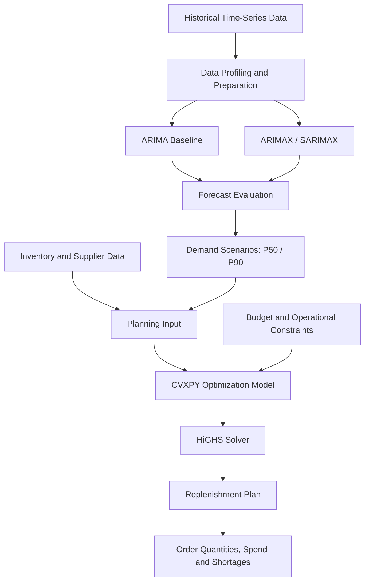

# 🇰🇪 Kenyan Supply & Replenishment Planning Core

**A Python-based demand forecasting and constrained inventory optimization engine for wholesale, retail, and distribution operations in Kenya.**

[](https://www.python.org/)
[](#-forecasting-engine)
[](https://www.cvxpy.org/)
[](#-public-data-source)
[](#-license)

---

## Overview

The **Kenyan Supply & Replenishment Planning Core** is a reproducible Python data science and mathematical optimization project designed to support inventory replenishment decisions under demand uncertainty, supplier limitations, storage constraints, and fixed purchasing budgets.

The engine connects two major analytical components:

1. **Time-series forecasting:** Uses ARIMA and ARIMAX/SARIMAX to model historical observations and evaluate whether external variables improve forecasting performance.
2. **Constrained replenishment optimization:** Uses CVXPY and the HiGHS solver to translate demand scenarios, inventory positions, and operational constraints into executable purchasing recommendations.

The project intentionally excludes websites, dashboards, and web servers. Its focus is the analytical backend: clean data processing, statistical modeling, optimization, and reproducible outputs.

## Table of Contents

- [Problem Statement](#-problem-statement)
- [Solution Architecture](#-solution-architecture)
- [Forecasting Engine](#-forecasting-engine)
- [Optimization Engine](#-optimization-engine)
- [Public Data Source](#-public-data-source)
- [Project Structure](#-project-structure)
- [Installation](#-installation)
- [Usage](#-usage)
- [Input Data Specification](#-input-data-specification)
- [Outputs](#-outputs)
- [Technical Stack](#-technical-stack)
- [Modeling Assumptions and Limitations](#-modeling-assumptions-and-limitations)
- [Future Improvements](#-future-improvements)
- [License](#-license)

---

## 🎯 Problem Statement

Retailers, wholesalers, and distributors must continuously balance product availability against purchasing costs and operational limitations.

In the Kenyan supply chain environment, replenishment decisions can be affected by:

- Fluctuating market prices and changing demand patterns.
- Supplier lead times and inconsistent delivery schedules.
- Limited warehouse and storage capacity.
- Minimum purchasing quantities and supplier-specific order multiples.
- Restricted procurement budgets and working capital.
- The financial consequences of stockouts and excess inventory.

Traditional static replenishment rules may not adequately represent these competing factors.

Furthermore, a statistical forecast alone does not produce a practical procurement decision. Businesses need a way to translate forecast uncertainty into purchasing quantities while respecting real operational constraints.

This project addresses that gap by combining statistical forecasting with mathematical optimization.

## 🏗️ Solution Architecture

The project follows a modular analytical pipeline:



### Pipeline stages

| Stage | Responsibility | Technology |
|---|---|---|
| Data preparation | Profile, validate, and prepare historical data | Pandas, NumPy |
| Baseline forecasting | Establish a univariate forecasting benchmark | ARIMA |
| Exogenous forecasting | Evaluate external explanatory variables | ARIMAX / SARIMAX |
| Scenario generation | Supply P50 and P90 demand estimates | Forecasting pipeline |
| Optimization | Calculate constrained purchasing quantities | CVXPY |
| Solver execution | Solve the optimization problem | HiGHS |

---

## 📈 Forecasting Engine

The forecasting component establishes a statistical foundation for replenishment planning.

### 1. ARIMA — Univariate Baseline

ARIMA models the target time series using its historical observations.

It provides a baseline against which more complex forecasting approaches can be evaluated.

The model considers:

- Autoregressive components (AR).
- Differencing (I).
- Moving-average components (MA).

### 2. ARIMAX / SARIMAX — Exogenous Modeling

The extended forecasting approach incorporates external explanatory variables where appropriate.

Potential variables include:

- Related commodity prices.
- Historical market price movements.
- Commercial indicators.
- Seasonal and calendar-related factors.
- Other relevant external market variables.

The purpose is to determine whether additional information improves forecasting performance compared with the univariate baseline.

**Important:** External variables used for forecasting must be available at prediction time. Future values must be known or independently projected; historical values alone cannot be treated as known future information.

### Current Forecasting Benchmark

The included WFP Kenya public market-price dataset was used for a six-month holdout experiment.

| Parameter | Value |
|---|---|
| Market | Nairobi |
| Target | Oil (vegetable) |
| Exogenous variable | Bread |
| Holdout period | 6 months |
| Forecast horizon | 6 months |
| ARIMA WAPE | 23.13% |
| ARIMAX WAPE | 23.62% |

**Interpretation:** In this particular experiment, ARIMA achieved a lower WAPE than ARIMAX. The additional explanatory variable did not improve the reported result.

These measurements demonstrate price-series forecasting performance, not internal business demand forecasting accuracy.

---

## 📦 Optimization Engine

The replenishment component uses **CVXPY** to formulate inventory purchasing decisions as a constrained optimization problem.

The model takes the following information:

- P50 demand forecast.
- P90 demand forecast.
- Current inventory position.
- Unit purchasing cost.
- Holding cost.
- Shortage penalty.
- Supplier capacity.
- Warehouse storage capacity.
- Supplier order multiples.
- Total purchasing budget.

### Optimization objective

The objective is to balance inventory holding costs against shortage penalties while respecting purchasing and operational constraints.

Conceptually:

$$
\min \quad \text{Holding Cost} + \text{Shortage Penalty}
$$

Subject to:

$$
\text{Purchasing Spend} \leq \text{Budget}
$$

$$
0 \leq Q_i \leq \text{Supplier Capacity}_i
$$

$$
\text{Ending Inventory}_i \leq \text{Storage Capacity}_i
$$

$$
Q_i \geq 0
$$

Where:

- $Q_i$ represents the purchasing quantity for SKU $i$.
- Inventory position represents available inventory after accounting for relevant stock movements and outstanding orders.
- Demand scenarios represent different levels of expected demand.

### Order Multiples

Where supported by the model configuration, purchasing quantities are constrained to supplier-defined order multiples. For example, a supplier may require purchasing in cartons of 12 units rather than individual units.

The integer decision variable can be represented as:

$$
Q_i = M_i Z_i
$$

Where:

- $M_i$ is the supplier order multiple.
- $Z_i$ is a non-negative integer decision variable.

CVXPY uses the HiGHS solver when available to solve the resulting mixed-integer optimization problem.

### Optimization Outputs

The engine reports:

| Output | Description |
|---|---|
| Solver status | Optimization result status |
| Order quantity | Recommended purchasing quantity |
| Total spend | Purchasing expenditure in KSh |
| Ending inventory | Projected inventory after replenishment |
| Shortage units | Unfulfilled demand under the modeled scenario |

The result is intended to support transparent, constraint-aware replenishment planning.

---

## 🌍 Public Data Source

### World Food Programme (WFP) — Kenya Market Prices

The repository includes a public market-price dataset:

`data/public/wfp_food_prices_ken.csv`

**Source:** [Humanitarian Data Exchange (HDX)](https://data.humdata.org/)

The dataset provides historical Kenyan market-price observations that can be used to demonstrate reproducible time-series analysis.

**Data interpretation matters:**

This dataset contains public market-price observations. It does not contain private retailer sales, company inventory movements, customer transactions, or internal sell-through history.

Consequently:

- Price forecasts are not demand forecasts.
- Public price-model accuracy is not company demand-model accuracy.
- Forecasting results do not establish realized inventory savings.
- Internal planning decisions require appropriate business inventory and demand data.

This distinction is maintained throughout the project to avoid overstating model performance.

---

## 📁 Project Structure

```text
kenyan-supply-replenishment-core/
│
├── data/
│   ├── public/
│   │   └── wfp_food_prices_ken.csv
│   │
│   ├── processed/
│   │   └── core_model/
│   │
│   └── optimization_input_template.csv
│
├── scripts/
│   ├── profile_public_data.py
│   ├── run_core_models.py
│   └── run_cvpy_plan.py
│
├── docs/
│   └── ...
│
├── tests/
│   └── ...
│
├── requirements.txt
├── .gitignore
└── README.md
```

*The structure above documents the intended repository organization; retain only directories and files that actually exist in your repository.*

---

## ⚙️ Installation

### Prerequisites

- Python 3.10 or later.
- pip.
- Git.
- A compatible CVXPY solver installation.

### 1. Clone the repository

```bash
git clone https://github.com/YOUR_USERNAME/kenyan-supply-replenishment-core.git

cd kenyan-supply-replenishment-core
```

### 2. Create a virtual environment

```bash
python3 -m venv .venv

source .venv/bin/activate
```

### 3. Upgrade pip

```bash
python3 -m pip install --upgrade pip
```

### 4. Install dependencies

```bash
python3 -m pip install -r requirements.txt
```

Ensure the dependency file includes the project's core libraries:

```text
pandas
numpy
statsmodels
cvxpy
highspy
```

Additional dependencies should be included where required by the implementation.

---

## 🚀 Usage

All commands should be executed from the repository root with the virtual environment activated.

### Step 1: Profile the public dataset

```bash
python3 scripts/profile_public_data.py
```

This runs the public dataset profiling workflow.

### Step 2: Run ARIMA and ARIMAX forecasting

```bash
python3 scripts/run_core_models.py \
    --market Nairobi \
    --target 'Oil (vegetable)' \
    --exog Bread \
    --holdout 6 \
    --horizon 6
```

The forecasting pipeline generates model forecasts and evaluation metrics.

Expected output location:

```text
data/processed/core_model/
```

### Step 3: Prepare replenishment planning data

Start with:

```text
data/optimization_input_template.csv
```

Populate it with the relevant SKU, inventory, demand, supplier, and cost information.

### Step 4: Run the optimization engine

```bash
python3 scripts/run_cvpy_plan.py \
    --planning-input path/to/employer_planning_input.csv \
    --budget-ksh 250000
```

The optimization engine evaluates the planning inputs against the specified KSh 250,000 purchasing budget.

---

## 📋 Input Data Specification

The optimization input CSV requires the following columns:

| Column | Description |
|---|---|
| `sku_id` | Unique product identifier |
| `location_id` | Warehouse, branch, or distribution location |
| `p50_demand` | Central demand scenario |
| `p90_demand` | Higher-demand risk scenario |
| `inventory_position` | Current inventory position |
| `unit_cost_ksh` | Purchasing cost per unit in KSh |
| `storage_capacity` | Maximum storage capacity |
| `supplier_capacity` | Maximum supplier quantity |
| `order_multiple` | Required purchasing increment |
| `holding_cost_ksh` | Cost of holding one unit |
| `shortage_penalty_ksh` | Penalty associated with one unit of unmet demand |

### Example input

```csv
sku_id,location_id,p50_demand,p90_demand,inventory_position,unit_cost_ksh,storage_capacity,supplier_capacity,order_multiple,holding_cost_ksh,shortage_penalty_ksh
SKU001,Nairobi,120,160,40,250,300,200,12,15,100
SKU002,Kisumu,80,110,25,180,200,150,6,12,90
SKU003,Kakamega,60,85,20,320,150,100,10,20,120
```

*Illustrative values only. They are not actual supplier quotations or company inventory records.*

---

## 📊 Outputs

The optimization workflow is designed to produce a structured replenishment plan containing:

| Metric | Example interpretation |
|---|---|
| Solver status | Optimal, infeasible, or another solver status |
| SKU | Product being replenished |
| Location | Destination warehouse or branch |
| Recommended order | Units to purchase |
| Purchasing spend | Cost in Kenyan shillings |
| Ending inventory | Projected remaining stock |
| Shortage | Remaining unmet demand |

All results should be interpreted within the assumptions and constraints supplied to the model.

---

## 🧰 Technical Stack

| Technology | Purpose |
|---|---|
| Python | Core programming language |
| Pandas | Data manipulation and preparation |
| NumPy | Numerical computation |
| Statsmodels | ARIMA / SARIMAX modeling |
| CVXPY | Mathematical optimization modeling |
| HiGHS | Optimization solver |
| Git | Version control |

### Engineering principles

- Reproducible analytical workflows.
- Separation of public benchmarks and private business data.
- Transparent optimization constraints.
- Explicit currency handling in Kenyan shillings.
- Modular forecasting and optimization components.
- Evidence-based model evaluation.
- Clear reporting of infeasible and optimal solver outcomes.

---

## ⚠️ Modeling Assumptions and Limitations

This project is an analytical planning engine, not a production procurement system.

Important considerations:

1. **Demand data:** Public market prices cannot substitute for historical SKU-level sales or consumption data.
2. **Lead times:** P50 and P90 demand inputs must be estimated over the appropriate replenishment protection period.
3. **Forecast uncertainty:** Forecast quality depends on historical data quality, model specification, and future information availability.
4. **Supplier constraints:** Supplier capacity and order multiples must reflect actual procurement agreements.
5. **Storage constraints:** Warehouse capacities must use consistent units and reflect operational restrictions.
6. **Budget constraints:** Purchasing costs must be expressed consistently in Kenyan shillings.
7. **Optimization feasibility:** Strict operational constraints may make a planning problem infeasible. This should be reported rather than hidden.
8. **Solver availability:** Integer optimization requires a compatible mixed-integer solver, such as HiGHS.

The engine does not claim real-world procurement savings or production deployment without validation against actual operational data.

---

## 🔭 Future Improvements

Potential extensions include:

- [ ] SKU-level demand forecasting using actual sales and consumption history.
- [ ] Automated lead-time demand distribution estimation.
- [ ] Rolling-origin time-series cross-validation.
- [ ] Forecast prediction interval calibration.
- [ ] Multi-location inventory allocation.
- [ ] Supplier selection and procurement cost optimization.
- [ ] Transportation and distribution cost modeling.
- [ ] Safety stock and reorder-point analysis.
- [ ] Sensitivity analysis for budget and shortage penalties.
- [ ] Automated optimization testing and validation.
- [ ] Integration with ERP, POS, and inventory management systems.

These are proposed extensions, not claims about currently implemented functionality.

---

## 📜 License

A license has not yet been specified.

Before publishing the repository, add an appropriate open-source license if you intend to permit reuse, modification, and redistribution.

---

## Author

**Wickliff Momanyi Orina**

Python | Data Science | Data Engineering | Operations Research

GitHub: [@Wickliffo](https://github.com/Wickliffo)

---

*Built to explore how statistical forecasting and mathematical optimization can support more transparent, data-driven replenishment decisions in Kenya.*
